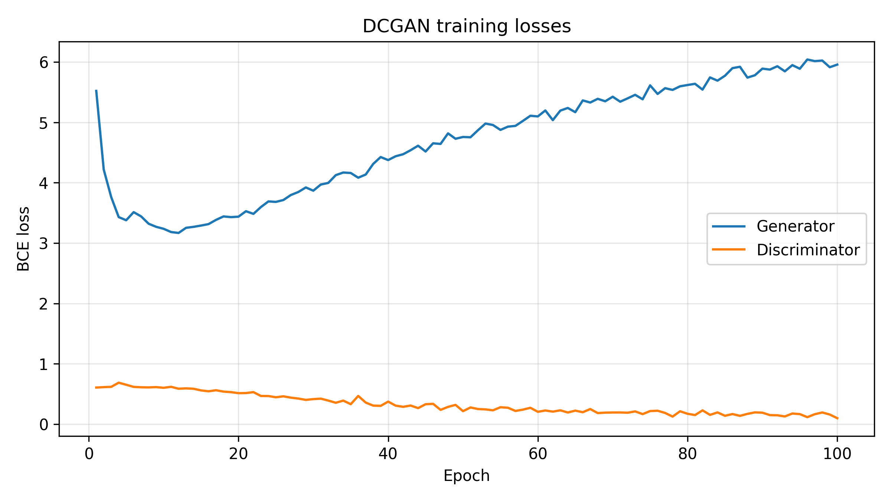
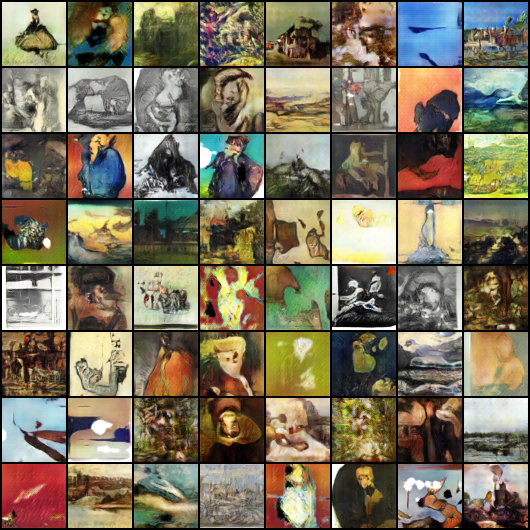

# Painting Generation with DCGAN on WikiArt

This project implements a deep convolutional generative adversarial network (DCGAN) in PyTorch to generate 64 × 64 RGB paintings from 100-dimensional Gaussian noise.

## Setup and usage

### Environment

- Python 3.13
- PyTorch 2.6.0 with CUDA 12.4

### Install dependencies

For GPU training, install the CUDA-enabled PyTorch 2.6.0 and torchvision 0.21.0 builds for your environment.

```bash
python -m pip install -r requirements.txt
```

### Run

Launch JupyterLab from the project root. Open `as2.ipynb` and execute the cells in order. Training results and model weights are saved in `dcgan_results/`. To resume from your checkpoint, set `RESUME = True` and set `EPOCHS` to the desired total.

## Dataset

The project uses the [HugGAN WikiArt dataset](https://huggingface.co/datasets/huggan/wikiart), with 73,299 training images and 8,145 held-out images. Artist, genre, and style labels are unused in this unconditional model.

Place the original `wikiart-train-*.arrow` shards in `dataset/`, or let the notebook download the pinned dataset revision. Allow roughly 65 GiB or more for the download, processed data, and resized cache. Images are converted to RGB, resized with their aspect ratios preserved, and center-cropped to 64 × 64. The notebook caches the crops as `uint8` and scales pixels to [−1, 1] when loading them.

## Model and training

The generator uses five transposed convolutions with 512, 256, 128, 64, and 3 output channels. Intermediate layers use batch normalization and ReLU, and the output layer uses Tanh. The discriminator uses five convolutions with 64, 128, 256, 512, and 1 output channels, with LeakyReLU in the intermediate layers. It outputs one logit per image.

Each batch updates the discriminator using binary cross-entropy on real and generated images, then updates the generator using real labels for its generated images while holding the discriminator parameters fixed.

| Parameter | Value |
|---|---|
| Image size | 64 × 64 RGB |
| Latent dimension | 100 |
| Optimizer | Adam |
| Learning rate | 0.0002 for both networks |
| Adam betas | (0.5, 0.999) |
| Batch size | 64 |
| Training epochs | 100 |
| Training and split seed | 42 |

## Results

### Training loss

Generator loss fell from 5.52 at epoch 1 to 3.17 at epoch 12, then rose to 5.96 at epoch 100. Discriminator loss fell from 0.606 to 0.098 over the run.



| Final training loss | Value |
|---|---:|
| Generator | 5.9574 |
| Discriminator | 0.0981 |

### Generated images

The grid shows images from fixed Gaussian latent vectors at epoch 100. Several samples have recognizable landscapes, buildings, and portrait-like figures. Some subjects still have blurred edges or distorted shapes.



### Evaluation

FID compares 5,000 generated images with 5,000 held-out WikiArt images using 2,048-dimensional Inception-v3 pooling features from `pytorch-fid`. Inception Score uses only the generated images and is computed from torchvision's ImageNet-pretrained Inception-v3 class probabilities. Both metrics are computed using PyTorch-Ignite.

| Epoch | FID | Inception Score |
|---:|---:|---:|
| 3 | 242.15 | 2.50 |
| 20 | 69.06 | 5.05 |
| 30 | 58.91 | 4.92 |
| 50 | 51.76 | 5.14 |
| 70 | 53.23 | 5.27 |
| 100 | 51.88 | 5.18 |

FID changed little across the evaluated checkpoints after epoch 50. The [epoch-100 metrics](examples/metrics.json) record the final evaluation settings and scores.


